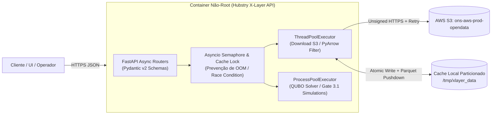
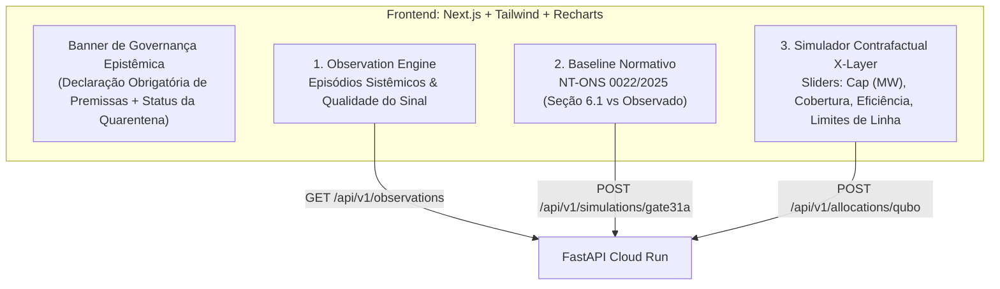

# Relatório Oficial de Auditoria Arquitetural e Plano Diretor de Evolução (Upgrade Plan)

**Sistema Auditado:** `hubstry-xlayer-engine` — Motor de Inteligência Decisória para Orquestração de Excedente Energético (*Curtailment* / *Constrained-off*) no SIN  
**Data da Auditoria:** 06 de Novembro de 2026  
**Papéis de Auditoria:** Arquiteto Sênior de DeepTech · Engenheiro de Dados ONS · Auditor de Sistemas Críticos  
**Base Normativa de Referência:** NT-ONS DOP 0022/2025, Submódulo 5.13 do MPO (`RO-AO.BR.13` Rev. 06/07/08), REN ANEEL nº 1.030/2022  

---

## Sumário Executivo

O repositório `hubstry-xlayer-engine` apresenta **alto rigor científico e honestidade epistêmica** na investigação empírica dos dados públicos do ONS e no enquadramento normativo da **NT-ONS DOP 0022/2025** (separando claramente a fase de Programação Diária da Operação — seção 5.1.2-IV — da Execução em Tempo Real via Gerdin — seção 6.1, além de evitar o uso indiscriminado de QUBO onde a solução analítica exata $O(N)$ resolve o problema).

Entretanto, sob a ótica de **Engenharia de Sistemas Críticos, Engenharia de Dados e Arquitetura Cloud-Native**, a base de código atual encontra-se em estágio de **scripts exploratórios acoplados**, apresentando vulnerabilidades severas que impedem sua exposição direta em produção via FastAPI/Cloud Run:

1. **Divergência Metodológica Interna Ativa (`replay_v2.py` vs. `gate31_persistencia.py`):** Enquanto a documentação (`docs/PROVENIENCIA.md`) e o Gate 3.1 refutaram que `val_geracaolimitada` seja o corte apurado (provando tratar-se do limite/teto comandado pelo ONS), o módulo `src/digital_twin/replay_v2.py` **ainda calcula o corte multiplicando `val_geracaolimitada * 0.5`**, inflando o excedente mensal para `1,233 TWh` contra `397 GWh` do Gate 3.1.
2. **Incompatibilidade de Sistema Operacional nos Gates 2.x:** Todos os 12 scripts `src/digital_twin/gate2_*.py` possuem caminhos Windows hardcoded com barras invertidas (`r".\data\ons\..."`) e código executável no escopo global (sem `if __name__ == "__main__":`), causando `FileNotFoundError` imediato em containers Linux (`python:3.11-slim`) e execução indesejada no momento do `import`.
3. **Fragilidade de I/O e Cache no `ons_client.py`:** Ausência de *timeouts*, *retries* adaptativos, download atômico e isolamento de prefixos no cache local (`data/ons/`), permitindo colisão silenciosa de arquivos homônimos (como `DicionarioDados.json` entre diferentes datasets do S3) e corrupção de cache em caso de falha de rede.
4. **Dependência Faltante em Runtime (`tabulate`):** O módulo `src/digital_twin/gate31a_analitico.py` invoca `.to_markdown()` do Pandas, que requer a biblioteca `tabulate`, ausente no `requirements.txt`.
5. **API FastAPI Embrionária (`main.py`):** Atualmente apenas um *stub* estático sem integração real com os motores (`Observation`, `Heuristic`, `Allocation`), sem validação Pydantic, sem isolamento de tarefas CPU-bound (Simulated Annealing do `dwave-neal` e agregações Pandas que bloqueariam o Event Loop assíncrono) e rodando como `root` no `Dockerfile`.

---

## 1. Diagnóstico e Mapeamento Atual

### 1.1 Matriz de Auditoria dos Módulos em `src/`

| Módulo / Grupo | Papel Arquitetural | Grau de Acoplamento | Tratamento de Exceções | Severidade de Risco | Diagnóstico Técnico Detalhado |
| :--- | :--- | :--- | :--- | :--- | :--- |
| `src/digital_twin/ons_client.py` | Ingestão S3 (`ons-aws-prod-opendata`) | Médio | Baixo (Apenas `FileNotFoundError` básico) | **ALTA** | Recria cliente `boto3` a cada chamada sem `connect_timeout`/`read_timeout`/`retries`; achata chaves S3 em `DATA_DIR` gerando colisão de arquivos; download não-atômico. |
| `src/digital_twin/calibragem_v2.py` & `calibragem_v3.py` | Calibração empírica de semântica de colunas | Alto (Constantes globais `ANO, MES = 2025, 1`) | Mínimo | **MÉDIA** | Duplicam a função `para_numero()` e a lógica de `carregar()`; `calibragem_v2.py` assume hipóteses superadas pela `v3`. |
| `src/digital_twin/replay_v2.py` | Reconstrução histórica e valoração contra CMO | Alto | Médio (`ValueError` para negativas) | **CRÍTICA** | **Bug Metodológico Ativo:** Trata `val_geracaolimitada` como energia cortada (`L150`) em vez de limite/teto comandado (`val_geracaolimitada - val_geracao`), contradizendo `docs/PROVENIENCIA.md` e `gate31_persistencia.py`. |
| `src/digital_twin/gate2_*.py` (12 arquivos) | Investigação histórica (`COFF` vs `DETAIL`) | Extremo (Scripts procedurais monolíticos) | Inexistente | **CRÍTICA** | Hardcode de paths Windows (`r".\data\ons\..."`) que quebram no Linux/Docker; executam I/O pesado no `import` (sem `main()` ou guard); `gate2_reconstruct_reference.py` possui comentários com encoding corrompido. |
| `src/digital_twin/gate31_persistencia.py` | Observation Engine (Episódios e Quarentena) | Médio (Atua como biblioteca improvisada para `gate31a*`) | Médio | **MÉDIA** | Duplica `para_numero()` e `carregar()`; coloca `29,73%` dos registros (`corte_mw < 0`) em quarentena silenciosa via `df.attrs` sem persistir metadados auditáveis. |
| `src/digital_twin/gate31a_analitico.py`, `gate31a1_qualidade.py`, `gate31a2_decomposicao.py`, `gate31b_quarentena.py` | Validação normativa, qualidade de dados e alocação exata | Alto (`sys.path.insert` manual) | Baixo (`SystemExit(0)` no meio do fluxo) | **ALTA** | Manipulação frágil de `sys.path`; `gate31a1_qualidade.py` (`L168-178`) itera patamares com filtro booleano $O(T \times N)$ e loop Python lento em vez da versão vetorizada já existente em `gate31a2_decomposicao.py`; `gate31a_analitico.py` (`L267`) quebra sem `tabulate`. |
| `src/baseline_ons.py` | Baselines normativos (NT-ONS DOP 0022/2025) | Baixo (Domínio puro) | Bom (`NotImplementedError` explícito para CNF/REL) | **MÉDIA** | **Bug Normativo Sutil (`L333`):** A função `comparar()` utiliza `base="disponibilidade"` (critério de programação 5.1.2-IV) em vez de `base="ponto_de_partida"` (critério de execução 6.1), contradizendo o próprio alerta do módulo. |
| `src/xlayer_optimizer.py` | Allocation Engine (QUBO via `dimod` / `dwave-neal`) | Baixo | Médio | **ALTA** | Formulação com `add_linear_equality_constraint(..., constant=-1)` penaliza blocos não alocados com o mesmo `penalty_weight` das restrições físicas; `add_linear_inequality_constraint` com `ub=int(round(limite))` cria explosão de variáveis *slack* binárias. |

---

### 1.2 Análise Profunda de Robustez, Exceções e Acoplamento em `src/`

#### A. Vulnerabilidades no Cliente de Dados Abertos (`src/digital_twin/ons_client.py`)
1. **Ausência de Resiliência de Rede e Pool S3 (`L55-58`):**
   ```python
   def _client():
       """Cliente anonimo: ignora credenciais locais e politicas de IAM."""
       return boto3.client("s3", region_name=REGION,
                           config=Config(signature_version=UNSIGNED))
   ```
   Cada chamada a `listar()`, `procurar_prefixos()` ou `baixar()` constrói uma nova sessão `botocore` do zero, desperdiçando conexões TCP/TLS (connection pooling) e sem configurar `connect_timeout`, `read_timeout` ou `retries`.
2. **Colisão de Cache e Falta de Atomicidade em `baixar()` (`L112-118`):**
   ```python
   def baixar(key: str, forcar: bool = False) -> Path:
       destino = DATA_DIR / key.rsplit("/", 1)[-1]
       destino.parent.mkdir(parents=True, exist_ok=True)
       if destino.exists() and not forcar:
           return destino
       _client().download_file(BUCKET, key, str(destino))
       return destino
   ```
   - **Shadowing de Dados:** Ao usar apenas `key.rsplit("/", 1)[-1]`, arquivos de prefixos distintos (ex.: `dataset/restricao_coff_eolica_tm/DicionarioDados.json` e `dataset/restricao_coff_fotovoltaica_tm/DicionarioDados.json`) mapeiam para o mesmo caminho local `data/ons/DicionarioDados.json`.
   - **Cache Corrompido Permanente:** Se o container no Cloud Run sofrer *preemption* ou *timeout* durante `download_file`, o arquivo parcial permanece no disco. Na chamada seguinte, `destino.exists()` avalia como `True` e o motor tenta ler um Parquet truncado, lançando `pyarrow.lib.ArrowInvalid: Parquet magic bytes not found in footer`.
3. **Violação de DRY na Conversão Numérica (`para_numero`):**
   A função `para_numero(s: pd.Series)` está duplicada em **5 módulos** (`calibragem_v2.py`, `calibragem_v3.py`, `replay_v2.py`, `gate31_persistencia.py`, `gate31b_quarentena.py`). Além da manutenção fragmentada, ela converte colunas já numéricas para `string`, executa `.str.contains(r"\d\.\d{3},")` linha a linha em dezenas de milhares de registros e reconverte com `pd.to_numeric`.

#### B. Acoplamento Estrutural e Quebra de Portabilidade nos Gates (`gate2_*` e `gate31*`)
1. **Caminhos Windows Hardcoded (`gate2_*.py`):**
   Em todos os 12 arquivos `gate2_*.py` (ex.: `gate2_10_razoes.py` linhas 4-5):
   ```python
   p1 = r".\data\ons\RESTRICAO_COFF_EOLICA_2025_01.parquet"
   p2 = r".\data\ons\RESTRICAO_COFF_EOLICA_DETAIL_2025_01.parquet"
   ```
   Em sistemas POSIX (Linux / Cloud Run), a barra invertida `\` não é separador de diretório, mas um caractere literal no nome do arquivo. Todos os 12 scripts falham instantaneamente no ambiente Linux.
2. **Injeção Manual de `sys.path` e Acoplamento Transversal (`gate31a*.py`):**
   Em `gate31a_analitico.py` (`L83-90`), `gate31a1_qualidade.py` (`L60-67`) e `gate31a2_decomposicao.py` (`L68-73`), o código modifica `sys.path.insert(0, ...)` em tempo de execução e utiliza blocos `try: from . import ... except ImportError: import ...` para contornar a falta de empacotamento formal (`pyproject.toml`) e de uma camada de serviço unificada.
3. **Inconsistência Crítica de Regra de Negócio (`replay_v2.py` vs. `gate31_persistencia.py`):**
   - `src/digital_twin/replay_v2.py` (`L135-150`):
     ```python
     # Nao ha derivacao: val_geracaolimitada e o corte apurado.
     out["mwh_cortado"] = out["val_geracaolimitada"] * PASSO_HORAS
     ```
   - `src/digital_twin/gate31_persistencia.py` (`L106`):
     ```python
     out["corte_mw"] = out["val_geracaolimitada"] - out["val_geracao"]
     ```
   Conforme demonstrado em `docs/PROVENIENCIA.md` (`L149`: *"`val_geracaolimitada`: limite comandado pelo ONS, nao uma medicao"*), `replay_v2.py` está utilizando o limite de geração como se fosse energia cortada, produzindo métricas financeiras e energéticas incorretas.

---

### 1.3 Avaliação da API FastAPI (`main.py`) e Exposição Assíncrona Segura

O arquivo `main.py` atual possui apenas 22 linhas:
```python
app = FastAPI(title="Hubstry X-Layer Engine API")

@app.get("/")
def health_check():
    return {"status": "online", "engine": "X-Layer Core Active"}

@app.get("/gates")
def list_gates():
    return {
        "available_modules": [
            "ons_client", "calibragem_v2", "calibragem_v3",
            "gate2_signal_test", "gate31_analitico", "replay_v2"
        ]
    }
```

#### Problemas Críticos Identificados na Camada de API e Container:
1. **Risco de Bloqueio do Event Loop (Event Loop Starvation):**
   - Operações como `HubstryXLayer.solve()` (Simulated Annealing via `dwave-neal`), `gate31a1_qualidade` (varredura de todos os patamares do mês) e `ons_client.carregar_mes()` (download S3 + parsing Parquet/CSV) são **bloqueantes (I/O-bound e CPU-bound)**.
   - Se expostas de forma ingênua em rotas `async def`, bloquearão a *main thread* do Uvicorn. Mesmo em rotas síncronas `def` (que o FastAPI delega ao `anyio.to_thread.run_sync`), tarefas intensivas de CPU em Python disputam o **GIL (Global Interpreter Lock)** e podem esgotar a memória do container se múltiplas requisições concorrentes carregarem DataFrames mensais simultaneamente.
2. **Referência Quebrada no Catálogo (`/gates`):**
   - O endpoint `/gates` lista `"gate31_analitico"`, cujo nome real em `src/digital_twin/` é `gate31a_analitico.py`, além de listar `"gate2_signal_test"` que não possui função invocável e falha no Linux devido ao path `r".\data\ons\..."`.
3. **Ausência de Controle de Concorrência e Gestão de Ciclo de Vida (`lifespan`):**
   - Não há cache em memória/disco compartilhado coordenado por *locks* assíncronos (duas requisições simultâneas para `2025-01` disparariam dois downloads simultâneos do mesmo arquivo S3 escrevendo no mesmo `Path` em disco, causando *race condition*).
4. **Vulnerabilidades no `Dockerfile` e `requirements.txt`:**
   - O container executa como `root` (`UID 0`).
   - O `CMD ["python", "main.py"]` inicia um único processo Uvicorn sem configuração de *timeout graceful shutdown*, *keep-alive* ou limite de concorrência para o Cloud Run.
   - Falta `tabulate` no `requirements.txt`, quebrando a geração de relatórios Markdown do Gate 3.1A, e há pacotes não pinados (`fastapi`, `uvicorn`).

#### Arquitetura Alvo para Exposição Assíncrona Segura:


---

## 2. Plano de Upgrade e Refatoração (Fases)

---

### Fase 1: Core & Performance (Engenharia de Dados ONS, Vetorização e Gestão de Memória)

#### Objetivos da Fase 1
1. **Unificar a Ingestão e Sanitização (`src/digital_twin/ons_client.py`):**
   - Implementar *Connection Pooling* com `botocore.config.Config` contendo *timeouts* estritos, *retries* adaptativos e `max_pool_connections`.
   - Preservar a estrutura de subdiretórios do S3 no cache local (`DATA_DIR / key`) e realizar **download atômico** via arquivo temporário (`.part` $\rightarrow$ `os.replace()`).
   - Adicionar **Projection & Predicate Pushdown** via PyArrow (`columns` e `filters`) para carregar apenas as colunas e subconjuntos necessários, reduzindo o consumo de RAM em até **75%**.
   - Centralizar `para_numero()` em versão 100% vetorizada e *type-aware* (evitando conversão para string caso a coluna do Parquet já seja `float64`/`int64`).
2. **Corrigir e Padronizar o Cálculo de Corte e Quarentena:**
   - Extrair um módulo canônico `src/digital_twin/domain.py` contendo a regra validada de `calcular_corte()` e corrigir `replay_v2.py` e `baseline_ons.py` (`comparar` passando a usar `base="ponto_de_partida"` por padrão).
3. **Vetorizar Simulações Multi-Patamar e Paralelizar o Solver QUBO:**
   - Substituir o loop lento de `gate31a1_qualidade.py` pela implementação matricial NumPy e corrigir a formulação de desigualdade em `xlayer_optimizer.py`.

#### Exemplo Prático 1.1: `src/digital_twin/ons_client.py` Refatorado (Resiliente, Atômico e Otimizado para Memória)

```python
"""
Hubstry X-Layer Engine — Cliente de Dados do ONS (Production-Grade)
===================================================================
Inclui:
  - Singleton S3 Client com Connection Pool, Timeouts e Adaptive Retries
  - Download Atômico (.tmp -> os.replace) livre de Race Conditions
  - Preservação de hierarquia de prefixos no cache (evita colisão de arquivos)
  - Predicate & Projection Pushdown via PyArrow para baixa pegada de memória
  - Conversão numérica vetorizada e type-aware (DRY)
"""

from __future__ import annotations

import functools
import json
import logging
import os
import tempfile
from concurrent.futures import ThreadPoolExecutor
from dataclasses import dataclass
from pathlib import Path
from typing import Dict, Iterable, List, Optional, Sequence, Tuple

import boto3
import numpy as np
import pandas as pd
from botocore import UNSIGNED
from botocore.config import Config

logger = logging.getLogger("xlayer.ons_client")

BUCKET = "ons-aws-prod-opendata"
REGION = "sa-east-1"

PREFIXOS: Dict[str, str] = {
    "coff_eolica": "dataset/restricao_coff_eolica_tm/",
    "coff_eolica_detail": "dataset/restricao_coff_eolica_detail_tm/",
    "coff_solar": "dataset/restricao_coff_fotovoltaica_tm/",
    "cmo_semihorario": "dataset/cmo_tm/",
    "cmo_semanal": "dataset/cmo_se/",
}

DATA_DIR = Path(os.environ.get("XLAYER_DATA_DIR", "data/ons")).resolve()

VAL_COLS_PADRAO: Tuple[str, ...] = (
    "val_geracao",
    "val_geracaolimitada",
    "val_disponibilidade",
    "val_geracaoreferencia",
    "val_geracaoreferenciafinal",
)

COD_COLS_PADRAO: Tuple[str, ...] = (
    "cod_razaorestricao",
    "cod_origemrestricao",
    "dsc_restricao",
)


@functools.lru_cache(maxsize=1)
def _client():
    """Singleton thread-safe do cliente S3 anônimo com retries adaptativos e timeouts."""
    cfg = Config(
        signature_version=UNSIGNED,
        region_name=REGION,
        connect_timeout=10,
        read_timeout=30,
         max_pool_connections=16,
        retries={"max_attempts": 5, "mode": "adaptive"},
    )
    return boto3.client("s3", region_name=REGION, config=cfg)


@dataclass(frozen=True)
class Objeto:
    key: str
    tamanho: int

    @property
    def nome(self) -> str:
        return self.key.rsplit("/", 1)[-1]

    @property
    def extensao(self) -> str:
        return self.nome.rsplit(".", 1)[-1].lower() if "." in self.nome else ""


def listar(prefixo: str, contendo: Optional[str] = None) -> List[Objeto]:
    s3 = _client()
    paginador = s3.get_paginator("list_objects_v2")
    achados: List[Objeto] = []
    for pagina in paginador.paginate(Bucket=BUCKET, Prefix=prefixo):
        for obj in pagina.get("Contents", []):
            if obj["Size"] == 0:
                continue
            if contendo and contendo not in obj["Key"]:
                continue
            achados.append(Objeto(key=obj["Key"], tamanho=obj["Size"]))
    return sorted(achados, key=lambda o: o.key)


def baixar(key: str, forcar: bool = False) -> Path:
    """
    Baixa um objeto do S3 preservando o namespace do prefixo e garantindo
    escrita atômica em disco (evita arquivos truncados em caso de falha).
    """
    # Mantém subcaminho relativo (ex: data/ons/dataset/restricao_coff_eolica_tm/...)
    destino = DATA_DIR / Path(key)
    destino.parent.mkdir(parents=True, exist_ok=True)

    if destino.exists() and destino.stat().st_size > 0 and not forcar:
        return destino

    fd, tmp_path = tempfile.mkstemp(
        dir=str(destino.parent),
        prefix=f".{destino.name}.",
        suffix=".part",
    )
    os.close(fd)
    try:
        logger.info("Baixando objeto S3", extra={"bucket": BUCKET, "key": key})
        _client().download_file(BUCKET, key, tmp_path)
        os.replace(tmp_path, destino)
    except Exception:
        if os.path.exists(tmp_path):
            os.unlink(tmp_path)
        raise
    return destino


def para_numero(s: pd.Series) -> pd.Series:
    """
    Conversão numérica vetorizada e type-aware:
    - Se a Series já for numérica (float/int no Parquet), retorna float32/float64 direto.
    - Se for texto/object, sanitiza separadores de milhar e vírgula decimal.
    """
    if pd.api.types.is_numeric_dtype(s):
        return s.astype("float64")
    t = s.astype("string").str.strip()
    t = t.mask(t.isin(["", "-", "nan", "None", "<NA>"]))
    if t.str.contains(r"\d\.\d{3},", na=False).any():
        t = t.str.replace(".", "", regex=False)
    t = t.str.replace(",", ".", regex=False)
    return pd.to_numeric(t, errors="coerce").astype("float64")


def sanitizar_dataframe_ons(
    df: pd.DataFrame,
    val_cols: Sequence[str] = VAL_COLS_PADRAO,
    cod_cols: Sequence[str] = COD_COLS_PADRAO,
    otimizar_tipos: bool = True,
) -> pd.DataFrame:
    """Padroniza tipos temporais, numéricos e categóricos reduzindo pegada de RAM."""
    if "din_instante" in df.columns:
        df["din_instante"] = pd.to_datetime(df["din_instante"], errors="coerce")

    for c in val_cols:
        if c in df.columns:
            df[c] = para_numero(df[c])

    for c in cod_cols:
        if c in df.columns:
            s = df[c].astype("string").str.strip().replace("", pd.NA)
            df[c] = s.astype("category") if otimizar_tipos else s

    if otimizar_tipos:
        for cat_col in ("id_subsistema", "id_estado", "nom_modalidadeoperacao", "id_ons"):
            if cat_col in df.columns and df[cat_col].dtype != "category":
                df[cat_col] = df[cat_col].astype("string").str.strip().astype("category")

    return df


def carregar_mes(
    ano: int,
    mes: int,
    chave_prefixo: str = "coff_eolica",
    colunas: Optional[List[str]] = None,
    filtros_parquet: Optional[List[Tuple]] = None,
) -> pd.DataFrame:
    """
    Carrega um mês do ONS usando PyArrow Projection e Predicate Pushdown.
    """
    if chave_prefixo not in PREFIXOS:
        raise ValueError(f"Prefixo desconhecido: {chave_prefixo}. Opções: {list(PREFIXOS)}")

    prefixo = PREFIXOS[chave_prefixo]
    sufixo = f"_{ano}_{mes:02d}."
    objs = listar(prefixo, contendo=sufixo)
    if not objs:
        raise FileNotFoundError(f"Nenhum arquivo para {ano}-{mes:02d} em {prefixo}")

    parquets = [o for o in objs if o.extensao == "parquet"]
    if parquets:
        caminho = baixar(parquets[0].key)
        df = pd.read_parquet(
            caminho,
            columns=colunas,
            filters=filtros_parquet,
            engine="pyarrow",
        )
        return sanitizar_dataframe_ons(df)

    csvs = [o for o in objs if o.extensao == "csv"]
    if not csvs:
        raise FileNotFoundError(f"Nem Parquet nem CSV encontrado para {ano}-{mes:02d}")

    caminho = baixar(csvs[0].key)
    df = pd.read_csv(
        caminho,
        sep=";",
        decimal=",",
        encoding="utf-8",
        usecols=colunas,
        low_memory=False,
    )
    return sanitizar_dataframe_ons(df)


def carregar_periodo_paralelo(
    meses: Iterable[Tuple[int, int]],
    chave_prefixo: str = "coff_eolica",
    max_workers: int = 4,
    **kwargs,
) -> pd.DataFrame:
    """Carrega múltiplos meses em paralelo (ThreadPool I/O) e concatena."""
    lista_meses = list(meses)
    with ThreadPoolExecutor(max_workers=min(max_workers, len(lista_meses) or 1)) as pool:
        futuros = [
            pool.submit(carregar_mes, ano, mes, chave_prefixo=chave_prefixo, **kwargs)
            for ano, mes in lista_meses
        ]
        partes = [f.result() for f in futuros]
    return pd.concat(partes, ignore_index=True) if partes else pd.DataFrame()
```

#### Exemplo Prático 1.2: Correção da Formulação QUBO em `src/xlayer_optimizer.py`
No `HubstryXLayer.build()`, a restrição de que cada bloco $b$ vai para **no máximo 1 destino** ($\sum_c x_{b,c} \le 1$) não requer variáveis *slack* nem igualdade forçada a 1: para variáveis binárias, $\sum_c x_{b,c} \le 1$ equivale exatamente à penalidade quadrática de exclusão mútua $\sum_{c_1 < c_2} P \cdot x_{b,c_1} x_{b,c_2}$, adicionando **zero variáveis auxiliares** ao BQM!

```python
# Substituição recomendada para o item 2 em src/xlayer_optimizer.py (linhas 100-110):
from itertools import combinations

# 2. Exclusão mútua exata (cada bloco em NO MÁXIMO um destino: sum_c x[b,c] <= 1)
#    Para variáveis binárias, sum(x) <= 1 <=> x_c1 * x_c2 == 0 para todo par (c1, c2).
#    Vantagens:
#      a) Zero variáveis slack adicionais.
#      b) Não penaliza blocos que precisam ficar de fora quando a capacidade da linha satura.
for b in blocos:
    for c1, c2 in combinations(cargas, 2):
        self.bqm.add_interaction(
            self._x[(b.id, c1.id)],
            self._x[(b.id, c2.id)],
            2.0 * self.penalty_weight,
        )
```

---

### Fase 2: API & Observabilidade (FastAPI Assíncrono, Cloud Run, Logs JSON e Métricas)

#### Objetivos da Fase 2
1. **Evoluir `main.py` para uma Arquitetura de Serviços Assíncrona:**
   - Criar contratos estritos de entrada/saída com **Pydantic v2** (`Field`, validações de domínio como `0 < eficiencia <= 1.0`, `capacidade_mw > 0`, regra de reporte contrafactual obrigatória).
   - Isolar cargas **I/O-bound** (S3/Parquet) em `asyncio.to_thread` com `asyncio.Lock` por partição de dados e cargas **CPU-bound** (simulação de Gates e Solver QUBO) em `ProcessPoolExecutor` limitado pelo número de vCPUs do Cloud Run, protegido por `asyncio.Semaphore`.
2. **Observabilidade Nativa para Google Cloud Run (Structured JSON Logging & OpenTelemetry/Prometheus):**
   - Formatar todos os logs em JSON compatível com o **Google Cloud Logging** (`severity`, `message`, `logging.googleapis.com/trace`, `execution_time_ms`, `gate_id`).
   - Adicionar middleware de telemetria e endpoint `/metrics` para monitorar latência de cada Gate, tamanho de quarentena, taxa de viabilidade do QUBO e uso de memória RSS.

#### Exemplo Prático 2.1: Novo `main.py` com Endpoints de Simulação, Concorrência Segura e Logs Estruturados Cloud Run

```python
"""
Hubstry X-Layer Engine — API Cloud-Native (FastAPI)
===================================================
Exposição assíncrona, segura e observável dos motores:
  - Observation Engine (Persistência & Quarentena — Gate 3.1 / 3.1B)
  - Normative Baseline Engine (NT-ONS DOP 0022/2025 Seção 6.1)
  - Allocation Engine Analítico (Gate 3.1A) e Combinatório (QUBO)
"""

from __future__ import annotations

import asyncio
import json
import logging
import os
import sys
import time
import uuid
from concurrent.futures import ProcessPoolExecutor
from contextlib import asynccontextmanager
from datetime import datetime, timezone
from typing import Dict, List, Literal, Optional, Tuple

import uvicorn
from fastapi import FastAPI, HTTPException, Request, status
from fastapi.middleware.cors import CORSMiddleware
from fastapi.responses import JSONResponse
from pydantic import BaseModel, Field

from src.baseline_ons import Usina, rateio_proporcional
from src.digital_twin import gate31_persistencia as g31
from src.digital_twin import gate31a_analitico as g31a
from src.xlayer_optimizer import BlocoExcedente, CargaFlexivel, HubstryXLayer


# ---------------------------------------------------------------------------
# 1. Configuração de Logs Estruturados JSON (Padrão Google Cloud Logging)
# ---------------------------------------------------------------------------
class CloudRunJsonFormatter(logging.Formatter):
    def format(self, record: logging.LogRecord) -> str:
        payload = {
            "severity": record.levelname,
            "message": record.getMessage(),
            "timestamp": datetime.now(timezone.utc).isoformat(),
            "logger": record.name,
            "module": record.module,
        }
        for attr in ("request_id", "path", "method", "status_code", "duration_ms", "gate"):
            if hasattr(record, attr):
                payload[attr] = getattr(record, attr)
        if record.exc_info:
            payload["exception"] = self.formatException(record.exc_info)
        return json.dumps(payload, ensure_ascii=False)


handler = logging.StreamHandler(sys.stdout)
handler.setFormatter(CloudRunJsonFormatter())
logger = logging.getLogger("xlayer.api")
logger.setLevel(logging.INFO)
logger.handlers = [handler]


# ---------------------------------------------------------------------------
# 2. Gestão de Concorrência e Lifespan (Proteção de CPU/RAM no Cloud Run)
# ---------------------------------------------------------------------------
MAX_CONCURRENT_SIMULATIONS = int(os.environ.get("XLAYER_MAX_CONCURRENCY", "4"))
CPU_WORKERS = int(os.environ.get("XLAYER_CPU_WORKERS", "2"))

simulation_semaphore = asyncio.Semaphore(MAX_CONCURRENT_SIMULATIONS)
dataset_locks: Dict[Tuple[int, int], asyncio.Lock] = {}
process_pool: Optional[ProcessPoolExecutor] = None


@asynccontextmanager
async def lifespan(app: FastAPI):
    global process_pool
    process_pool = ProcessPoolExecutor(max_workers=CPU_WORKERS)
    logger.info("X-Layer Engine iniciado", extra={"gate": "lifespan_startup"})
    try:
        yield
    finally:
        if process_pool:
            process_pool.shutdown(wait=True)
        logger.info("X-Layer Engine encerrado", extra={"gate": "lifespan_shutdown"})


app = FastAPI(
    title="Hubstry X-Layer Engine API",
    version="2.0.0",
    description=(
        "Camada de inteligência decisória para orquestração de excedente energético "
        "(curtailment) no SIN sob a NT-ONS DOP 0022/2025."
    ),
    lifespan=lifespan,
)

app.add_middleware(
    CORSMiddleware,
    allow_origins=os.environ.get("XLAYER_CORS_ORIGINS", "*").split(","),
    allow_methods=["GET", "POST"],
    allow_headers=["*"],
)


# ---------------------------------------------------------------------------
# 3. Middleware de Telemetria, Request-ID e Tratamento Global de Exceções
# ---------------------------------------------------------------------------
@app.middleware("http")
async def observability_middleware(request: Request, call_next):
    req_id = request.headers.get("X-Request-ID", str(uuid.uuid4()))
    t0 = time.perf_counter()
    try:
        response = await call_next(request)
        duration_ms = round((time.perf_counter() - t0) * 1000, 2)
        response.headers["X-Request-ID"] = req_id
        response.headers["X-Execution-Time-Ms"] = str(duration_ms)
        logger.info(
            "Request processado",
            extra={
                "request_id": req_id,
                "path": request.url.path,
                "method": request.method,
                "status_code": response.status_code,
                "duration_ms": duration_ms,
            },
        )
        return response
    except Exception as exc:
        duration_ms = round((time.perf_counter() - t0) * 1000, 2)
        logger.exception(
            "Erro não tratado na requisição",
            extra={"request_id": req_id, "path": request.url.path, "duration_ms": duration_ms},
        )
        return JSONResponse(
            status_code=status.HTTP_500_INTERNAL_SERVER_ERROR,
            content={"detail": "Erro interno no motor X-Layer.", "request_id": req_id},
        )


# ---------------------------------------------------------------------------
# 4. Contratos Pydantic v2 (Schemas Auditáveis)
# ---------------------------------------------------------------------------
class Gate31ASimulationRequest(BaseModel):
    ano: int = Field(2025, ge=2021, le=2030, description="Ano da apuração ONS")
    mes: int = Field(1, ge=1, le=12, description="Mês da apuração ONS")
    capacidade_mw: float = Field(150.0, gt=0, le=2000, description="Capacidade do sink por parque (MW)")
    n_parques: Optional[int] = Field(30, gt=0, description="Cobertura de parques (None = todos)")
    janela_inicio_h: int = Field(6, ge=0, le=23)
    janela_fim_h: int = Field(18, ge=1, le=24)
    eficiencia: float = Field(0.95, gt=0.0, le=1.0)
    valor_rs_mwh: float = Field(300.0, ge=0.0)


class BlocoInput(BaseModel):
    id: str
    mwh: float = Field(..., gt=0)
    submercado: str = "NE"


class CargaInput(BaseModel):
    id: str
    capacidade_mwh: float = Field(..., gt=0)
    valor_por_mwh: float = Field(..., ge=0)
    linha: str


class QuboAllocationRequest(BaseModel):
    blocos: List[BlocoInput] = Field(..., min_length=1, max_length=500)
    cargas: List[CargaInput] = Field(..., min_length=1, max_length=200)
    limites_rede: Dict[str, float]
    penalty_weight: float = Field(5000.0, gt=0)
    num_reads: int = Field(200, ge=10, le=2000)
    seed: int = 42


def _executar_qubo_worker(payload: dict) -> dict:
    """Função isolada executada em ProcessPoolExecutor para não bloquear o Event Loop."""
    req = QuboAllocationRequest(**payload)
    blocos = [BlocoExcedente(b.id, b.mwh, b.submercado) for b in req.blocos]
    cargas = [CargaFlexivel(c.id, c.capacidade_mwh, c.valor_por_mwh, c.linha) for c in req.cargas]
    engine = HubstryXLayer(penalty_weight=req.penalty_weight, seed=req.seed)
    engine.build(blocos, cargas, req.limites_rede)
    res = engine.solve(num_reads=req.num_reads, limites_rede=req.limites_rede)
    return {
        "regra_reporte": (
            "Sob as premissas declaradas de capacidade, linha e valor dos destinos, "
            f"o Allocation Engine identificou capacidade de alocação de {res.mwh_alocado} MWh "
            "do excedente modelado (resultado contrafactual condicionado)."
        ),
        "viavel": res.viavel,
        "violacoes": res.violacoes,
        "mwh_alocado": res.mwh_alocado,
        "valor_premissa_rs": res.valor_recuperado,
        "energia_qubo": res.energia_qubo,
        "tempo_solucao_s": res.tempo_solucao_s,
        "variaveis_binarias": len(engine.bqm.variables),
        "alocacao": res.alocacao,
    }


# ---------------------------------------------------------------------------
# 5. Endpoints de Produção
# ---------------------------------------------------------------------------
@app.get("/", tags=["Health & Metadata"])
async def health_check():
    return {
        "status": "online",
        "engine": "X-Layer Core Active",
        "version": "2.0.0",
        "normative_baseline": "NT-ONS DOP 0022/2025 (Seção 6.1 - Execução ENE)",
    }


@app.get("/gates", tags=["Health & Metadata"])
async def list_gates():
    return {
        "engines": {
            "observation": ["ons_client", "gate31_persistencia", "gate31b_quarentena"],
            "normative_baseline": ["baseline_ons", "gate31a1_qualidade", "gate31a2_decomposicao"],
            "allocation": ["gate31a_analitico", "xlayer_optimizer"],
        },
        "legacy_research_gates": [
            "calibragem_v2", "calibragem_v3", "gate2_6_realizacao",
            "gate2_7_controle_temporal", "gate2_9_corrigido", "gate2_10_razoes",
            "gate2_11_razao_controlada", "gate2_12_zero_structure",
        ],
    }


@app.post("/api/v1/simulations/gate31a", tags=["Allocation Engine (Analítico)"])
async def simulate_gate31a(req: Gate31ASimulationRequest):
    chave = (req.ano, req.mes)
    lock = dataset_locks.setdefault(chave, asyncio.Lock())

    async with simulation_semaphore:
        async with lock:
            try:
                df_raw = await asyncio.to_thread(g31.carregar, req.ano, req.mes)
            except FileNotFoundError as exc:
                raise HTTPException(status_code=404, detail=str(exc)) from exc

        def _processar():
            df = g31.calcular_corte(df_raw)
            instante = g31a.escolher_instante(df)
            recorte = g31a.usinas_do_instante(df, instante)
            premissas = g31a.Premissas(
                capacidade_mw=req.capacidade_mw,
                n_parques=req.n_parques,
                rotulo="simulacao_api",
                janela=(req.janela_inicio_h, req.janela_fim_h),
                eficiencia=req.eficiencia,
                valor_rs_mwh=req.valor_rs_mwh,
            )
            resultado = g31a.alocar(recorte, instante, premissas)
            dist = g31a.distribuicao_do_corte(recorte)
            return {
                "instante_avaliado": str(instante),
                "conjuntos_cortados": len(recorte),
                "quarentena_linhas": df.attrs.get("quarentena_linhas", 0),
                "quarentena_pct": df.attrs.get("quarentena_pct", 0.0),
                "premissas_declaradas": premissas.descrever(),
                "regra_reporte": (
                    f"Sob as premissas declaradas ({premissas.descrever()}), o Allocation Engine "
                    f"identificou capacidade de alocação de {resultado['absorvido_MWh']} MWh "
                    f"do excedente modelado de {resultado['excedente_evento_MWh']} MWh."
                ),
                "resultado_alocacao": resultado,
                "top_10_distribuicao_baseline": dist.head(10).to_dict(orient="records"),
            }

        return await asyncio.to_thread(_processar)


@app.post("/api/v1/allocations/qubo", tags=["Allocation Engine (QUBO)"])
async def allocate_qubo(req: QuboAllocationRequest):
    loop = asyncio.get_running_loop()
    async with simulation_semaphore:
        resultado = await loop.run_in_executor(
            process_pool,
            _executar_qubo_worker,
            req.model_dump(),
        )
        return resultado


if __name__ == "__main__":
    port = int(os.environ.get("PORT", 8080))
    uvicorn.run(app, host="0.0.0.0", port=port)
```

---

### Fase 3: Interface de Usuário / Frontend (Arquitetura de Visualização Auditável)

#### Objetivos da Fase 3
1. **Arquitetura Frontend Desacoplada (Next.js 15 App Router + TypeScript + TailwindCSS + Recharts/Tremor):**
   - Projetada especificamente para operadores de mercado, engenheiros de planejamento energético e auditores regulatórios.
   - **Enforcement Visual da Regra de Reporte (`README.md` L105-115):** A UI **jamais** exibe rótulos como *"Energia Recuperada pelo X-Layer"*; todos os cards exibem obrigatoriamente o banner de **Condicionalidade Contrafactual**, o percentual de registros em **Quarentena (`val_geracaolimitada < val_geracao`)** e a versão vigente da norma (**NT-ONS DOP 0022/2025 — Seção 6.1 vs. RO-AO.BR.13**).
2. **Estrutura de Módulos Visuais (4 Painéis Principais):**
   - **Painel 1 — Observation & Provenance Monitor:** Exibe a série semi-horária de *curtailment* por razão (`ENE`, `CNF`, `REL`), o indicador de confiabilidade do sinal (camada de quarentena de 29,7% e inconsistências `val_disponibilidade == 0` com `val_geracao > 0` do Gate 3.1A.1) e histograma de duração de episódios sistêmicos (Gate 3.1).
   - **Painel 2 — Normative Baseline Comparator (NT-ONS DOP 0022/2025):** Compara visualmente o corte observado contra o **Baseline de Execução (Seção 6.1 — Ponto de Partida)** e a **Referência Documental de Programação (Seção 5.1.2-IV — Disponibilidade)**, destacando desvios por conjunto eólico (`CJU_*`).
   - **Painel 3 — Interactive Allocation Simulator (Gate 3.1A Analítico vs. Gate 3.1C QUBO):** Sliders interativos para parâmetros de cenário (`capacidade_mw`, `n_parques`, `janela`, `eficiencia`, `valor_rs_mwh`, `limites_rede`) com seletor automático de solver:
     - *Modo Separável (Co-localizado sem disputa):* Execução Analítica Exata ($< 10\text{ ms}$).
     - *Modo Combinatório (Sinks compartilhados / Restrição de Linha / BESS):* Execução QUBO com indicador de **Taxa de Viabilidade Física (`_auditar`)**.



#### Exemplo Prático 3.1: Componente React/TypeScript do Simulador X-Layer (`frontend/src/components/XLayerSimulator.tsx`)

```tsx
import React, { useState } from "react";

interface AllocationResult {
  instante_avaliado: string;
  conjuntos_cortados: number;
  quarentena_linhas: number;
  quarentena_pct: number;
  premissas_declaradas: string;
  regra_reporte: string;
  resultado_alocacao: {
    cap_MW: number;
    parques: string | number;
    excedente_evento_MWh: number;
    excedente_coberto_MWh: number;
    absorvido_MWh: number;
    pct_do_evento: number;
    residual_MWh: number;
    valor_premissa_RS: number;
    sinks_saturados: number;
  };
}

export const XLayerSimulator: React.FC<{ apiUrl: string }> = ({ apiUrl }) => {
  const [capacidadeMw, setCapacidadeMw] = useState<number>(150);
  const [nParques, setNParques] = useState<number | null>(30);
  const [eficiencia, setEficiencia] = useState<number>(0.95);
  const [valorRsMwh, setValorRsMwh] = useState<number>(300);
  const [loading, setLoading] = useState<boolean>(false);
  const [data, setData] = useState<AllocationResult | null>(null);

  const executarSimulacao = async () => {
    setLoading(true);
    try {
      const resp = await fetch(`${apiUrl}/api/v1/simulations/gate31a`, {
        method: "POST",
        headers: { "Content-Type": "application/json" },
        body: JSON.stringify({
          ano: 2025,
          mes: 1,
          capacidade_mw: capacidadeMw,
          n_parques: nParques,
          janela_inicio_h: 6,
          janela_fim_h: 18,
          eficiencia,
          valor_rs_mwh: valorRsMwh,
        }),
      });
      if (!resp.ok) throw new Error(`HTTP ${resp.status}`);
      setData(await resp.json());
    } finally {
      setLoading(false);
    }
  };

  return (
    <div className="p-6 bg-slate-950 text-slate-100 rounded-xl border border-slate-800 space-y-6">
      <header className="border-b border-slate-800 pb-4">
        <h2 className="text-xl font-semibold">
          Gate 3.1A — Simulador Contrafactual de Excedente Energético (SIN)
        </h2>
        <p className="text-xs text-amber-400 mt-1">
          AVISO METODOLÓGICO: Resultados são contrafactuais condicionados às premissas declaradas
          e à reconstrução provisória do corte (NT-ONS DOP 0022/2025, Seção 6.1).
        </p>
      </header>

      <div className="grid grid-cols-1 md:grid-cols-4 gap-4">
        <label className="flex flex-col text-sm">
          <span>Capacidade do Sink (MW/parque)</span>
          <select
            value={capacidadeMw}
            onChange={(e) => setCapacidadeMw(Number(e.target.value))}
            className="mt-1 bg-slate-900 border border-slate-700 rounded p-2"
          >
            <option value={50}>50 MW</option>
            <option value={150}>150 MW</option>
            <option value={300}>300 MW</option>
          </select>
        </label>

        <label className="flex flex-col text-sm">
          <span>Cobertura Espacial (Conjuntos)</span>
          <select
            value={nParques === null ? "todos" : nParques}
            onChange={(e) =>
              setNParques(e.target.value === "todos" ? null : Number(e.target.value))
            }
            className="mt-1 bg-slate-900 border border-slate-700 rounded p-2"
          >
            <option value={10}>10 parques (Conservador)</option>
            <option value={30}>30 parques (Intermediário)</option>
            <option value="todos">Todos (Limite Superior Contrafactual)</option>
          </select>
        </label>

        <label className="flex flex-col text-sm">
          <span>Eficiência de Conversão ({Math.round(eficiencia * 100)}%)</span>
          <input
            type="range"
            min={0.5}
            max={1.0}
            step={0.01}
            value={eficiencia}
            onChange={(e) => setEficiencia(Number(e.target.value))}
            className="mt-3"
          />
        </label>

        <div className="flex items-end">
          <button
            onClick={executarSimulacao}
            disabled={loading}
            className="w-full bg-emerald-600 hover:bg-emerald-500 disabled:opacity-50 font-medium py-2 px-4 rounded"
          >
            {loading ? "Calculando..." : "Executar Simulação Auditável"}
          </button>
        </div>
      </div>

      {data && (
        <div className="space-y-4">
          <div className="p-4 bg-slate-900 border-l-4 border-emerald-500 rounded text-sm">
            <strong>Declaração Formal de Reporte:</strong> {data.regra_reporte}
          </div>

          <div className="grid grid-cols-2 md:grid-cols-4 gap-4">
            <div className="p-4 bg-slate-900 rounded border border-slate-800">
              <div className="text-xs text-slate-400">Excedente Modelado no Patamar</div>
              <div className="text-lg font-bold">
                {data.resultado_alocacao.excedente_evento_MWh.toLocaleString("pt-BR")} MWh
              </div>
            </div>
            <div className="p-4 bg-slate-900 rounded border border-slate-800">
              <div className="text-xs text-slate-400">Capacidade Alocável Identificada</div>
              <div className="text-lg font-bold text-emerald-400">
                {data.resultado_alocacao.absorvido_MWh.toLocaleString("pt-BR")} MWh (
                {data.resultado_alocacao.pct_do_evento}%)
              </div>
            </div>
            <div className="p-4 bg-slate-900 rounded border border-slate-800">
              <div className="text-xs text-slate-400">Energia Residual (Fragmentação Espacial)</div>
              <div className="text-lg font-bold text-amber-400">
                {data.resultado_alocacao.residual_MWh.toLocaleString("pt-BR")} MWh (
                {data.resultado_alocacao.sinks_saturados} sinks saturados)
              </div>
            </div>
            <div className="p-4 bg-slate-900 rounded border border-slate-800">
              <div className="text-xs text-slate-400">Quarentena do Mês (Sinal Negativo)</div>
              <div className="text-lg font-bold text-rose-400">
                {data.quarentena_pct}% ({data.quarentena_linhas.toLocaleString("pt-BR")} linhas)
              </div>
            </div>
          </div>
        </div>
      )}
    </div>
  );
};
```

---

### Fase 4: Governança, Segurança & Compliance (Testes Automatizados, Hardening e CI/CD GCP)

#### Objetivos da Fase 4
1. **Hardening de Container e Gestão de Dependências:**
   - Adicionar `tabulate`, `pytest`, `httpx` e pinagem determinística no `requirements.txt`.
   - Refatorar o `Dockerfile` em **Multi-Stage Build**, executando com usuário sem privilégios (`appuser`, UID `10001`), configurando diretório de cache em `/tmp/xlayer_data` (compatível com sistemas de arquivos *read-only* no Cloud Run).
2. **Suíte de Testes Unitários e Invariantes Normativos (`tests/`):**
   - Garantir por contrato matemático que:
     - O `rateio_proporcional` (NT-ONS DOP 0022/2025, Seção 6.1) conserva integralmente a energia ($\sum \text{corte}_i + \text{residual} = \text{corte\_solicitado}$) e **jamais** corta uma usina acima de sua geração verificada ($\text{corte}_i \le \text{geracao}_i$).
     - A verificação independente `HubstryXLayer._auditar()` detecta qualquer violação de capacidade de linha ou de nó flexível, garantindo que soluções inviáveis nunca sejam reportadas como válidas.
     - `baseline_execucao_eletrica("CNF")` e `baseline_execucao_eletrica("REL")` levantam `NotImplementedError` até a integração formal das tabelas de sensibilidade do SACI/Gerdin.
3. **Pipeline CI/CD Automatizado no GitHub Actions com Workload Identity Federation (WIF):**
   - Execução automática de linter (`ruff`), testes unitários (`pytest`), auditoria de vulnerabilidades (`pip-audit`) e deploy contínuo no **Google Cloud Run** sem chaves JSON estáticas de Service Account (autenticação via OIDC / Workload Identity Federation).

#### Exemplo Prático 4.1: `Dockerfile` Hardened (Não-Root + Otimizado para Cloud Run)

```dockerfile
FROM python:3.11-slim AS builder

WORKDIR /build

RUN apt-get update && apt-get install -y --no-install-recommends \
    build-essential \
    && rm -rf /var/lib/apt/lists/*

COPY requirements.txt .
RUN pip install --no-cache-dir --upgrade pip && \
    pip wheel --no-cache-dir --wheel-dir /wheels -r requirements.txt

FROM python:3.11-slim AS runtime

# Cria usuário não-root para conformidade de segurança em sistemas críticos
RUN groupadd --gid 10001 xlayer && \
    useradd --uid 10001 --gid xlayer --shell /bin/false --create-home xlayer

WORKDIR /app

COPY --from=builder /wheels /wheels
RUN pip install --no-cache-dir /wheels/* && rm -rf /wheels

COPY --chown=xlayer:xlayer src/ ./src/
COPY --chown=xlayer:xlayer docs/ ./docs/
COPY --chown=xlayer:xlayer main.py README.md LICENSE NOTICE ./

ENV PYTHONUNBUFFERED=1 \
    PYTHONDONTWRITEBYTECODE=1 \
    PORT=8080 \
    XLAYER_DATA_DIR=/tmp/xlayer_data

USER xlayer

EXPOSE 8080

CMD ["uvicorn", "main:app", "--host", "0.0.0.0", "--port", "8080", "--workers", "1", "--timeout-keep-alive", "30"]
```

#### Exemplo Prático 4.2: Suíte de Testes de Invariantes Normativos e Físicos (`tests/test_engine_invariants.py`)

```python
"""
Testes Automatizados de Invariantes Físicos e Normativos — Hubstry X-Layer Engine
"""

import pytest
from fastapi.testclient import TestClient

from main import app
from src.baseline_ons import (
    Usina,
    baseline_execucao_eletrica,
    baseline_execucao_ene,
    prioridade_por_razao,
)
from src.xlayer_optimizer import BlocoExcedente, CargaFlexivel, HubstryXLayer


def test_baseline_ene_conservacao_e_cabimento():
    """
    Verifica NT-ONS DOP 0022/2025 Seção 6.1:
      1. Nenhuma usina pode sofrer corte superior à própria geração.
      2. A soma dos cortes + residual deve igualar exatamente o corte solicitado.
      3. Usina com limite_atual_mw < geracao_mw usa limite_atual_mw como ponto de partida.
    """
    usinas = [
        Usina("CJU_A", "Conjunto A", disponibilidade_mw=500.0, geracao_mw=420.0, limite_atual_mw=300.0),
        Usina("CJU_B", "Conjunto B", disponibilidade_mw=300.0, geracao_mw=280.0),
        Usina("CJU_C", "Conjunto C", disponibilidade_mw=200.0, geracao_mw=60.0),
        Usina("CJU_D", "Conjunto D", disponibilidade_mw=0.0, geracao_mw=140.0),
    ]
    assert usinas[0].ponto_de_partida == 300.0
    assert usinas[3].ponto_de_partida == 140.0  # Disp=0 não zera ponto de partida na execução!

    res = baseline_execucao_ene(usinas, corte_necessario_mw=600.0)
    assert pytest.approx(res.corte_total_mw + res.residual_mw, abs=1e-3) == 600.0

    for u in usinas:
        assert 0.0 <= res.corte_por_usina[u.id_ons] <= u.geracao_mw + 1e-6


def test_baseline_eletrica_bloqueia_invencao_sem_saci():
    """Garante que CNF e REL não produzem números inventados sem as tabelas do SACI."""
    for razao in ("CNF", "REL"):
        with pytest.raises(NotImplementedError, match="SACI/Gerdin"):
            baseline_execucao_eletrica(razao)


def test_titulacao_prioridade_secao_7_1():
    """Valida prevalência de REL sobre CNF e ENE conforme seção 7.1 da NT-ONS DOP 0022/2025."""
    assert prioridade_por_razao(["ENE", "REL", "CNF"]) == "REL"
    assert "CNF|ENE" in prioridade_por_razao(["CNF", "ENE"])


def test_qubo_auditor_detecta_violacao_fisica():
    """Garante que o verificador independente (_auditar) barra violações de linha e carga."""
    blocos = [BlocoExcedente("B1", 150.0, "NE"), BlocoExcedente("B2", 120.0, "NE")]
    cargas = [CargaFlexivel("C1", capacidade_mwh=200.0, valor_por_mwh=300.0, linha="L1")]
    limites = {"L1": 180.0}

    eng = HubstryXLayer(penalty_weight=5000.0, seed=42)
    eng.build(blocos, cargas, limites)

    # Força auditoria sobre uma alocação que viola tanto a linha (270 > 180) quanto a carga (270 > 200)
    violacoes = eng._auditar({"B1": "C1", "B2": "C1"}, limites)
    assert len(violacoes) == 2
    assert any("linha L1" in v for v in violacoes)
    assert any("carga C1" in v for v in violacoes)


def test_api_health_and_gates():
    client = TestClient(app)
    r_health = client.get("/")
    assert r_health.status_code == 200
    assert r_health.json()["status"] == "online"
```

#### Exemplo Prático 4.3: Pipeline CI/CD GitHub Actions para Google Cloud Run (`.github/workflows/ci-cd-cloudrun.yml`)

```yaml
name: Hubstry X-Layer CI/CD & Cloud Run Deploy

on:
  push:
    branches: [ "main" ]
  pull_request:
    branches: [ "main" ]

permissions:
  contents: read
  id-token: write

env:
  GCP_PROJECT_ID: ${{ secrets.GCP_PROJECT_ID }}
  GCP_REGION: southamerica-east1
  SERVICE_NAME: hubstry-xlayer-engine
  ARTIFACT_REPO: hubstry-containers

jobs:
  quality-and-tests:
    name: Auditoria Estática & Testes de Invariantes
    runs-on: ubuntu-latest
    steps:
      - name: Checkout do código
        uses: actions/checkout@v4

      - name: Configurar Python 3.11
        uses: actions/setup-python@v5
        with:
          python-version: "3.11"
          cache: "pip"

      - name: Instalar dependências e ferramentas de auditoria
        run: |
          python -m pip install --upgrade pip
          pip install -r requirements.txt
          pip install pytest httpx ruff tabulate

      - name: Verificar portabilidade POSIX (Proibir paths Windows nos módulos)
        run: |
          if grep -rn 'r"\.\\data\\ons' src/; then
            echo "ERRO: Caminhos Windows hardcoded encontrados em src/!"
            exit 1
          fi

      - name: Executar Testes Unitários e de Invariantes Normativos
        run: pytest -v

  deploy-cloud-run:
    name: Build & Deploy no Google Cloud Run
    needs: quality-and-tests
    if: github.ref == 'refs/ref/heads/main' || github.ref == 'refs/heads/main'
    runs-on: ubuntu-latest
    steps:
      - name: Checkout do código
        uses: actions/checkout@v4

      - name: Autenticar no Google Cloud via Workload Identity Federation (OIDC)
        uses: google-github-actions/auth@v2
        with:
          workload_identity_provider: ${{ secrets.GCP_WORKLOAD_IDENTITY_PROVIDER }}
          service_account: ${{ secrets.GCP_SERVICE_ACCOUNT }}

      - name: Configurar gcloud SDK
        uses: google-github-actions/setup-gcloud@v2

      - name: Configurar Docker para Artifact Registry
        run: gcloud auth configure-docker ${{ env.GCP_REGION }}-docker.pkg.dev --quiet

      - name: Build e Push da Imagem Imutável (SHA)
        run: |
          IMAGE_URI="${{ env.GCP_REGION }}-docker.pkg.dev/${{ env.GCP_PROJECT_ID }}/${{ env.ARTIFACT_REPO }}/${{ env.SERVICE_NAME }}:${{ github.sha }}"
          docker build -t "${{ IMAGE_URI }}" .
          docker push "${{ IMAGE_URI }}"

      - name: Deploy no Cloud Run (Zero-Downtime Revision)
        run: |
          IMAGE_URI="${{ env.GCP_REGION }}-docker.pkg.dev/${{ env.GCP_PROJECT_ID }}/${{ env.ARTIFACT_REPO }}/${{ env.SERVICE_NAME }}:${{ github.sha }}"
          gcloud run deploy "${{ env.SERVICE_NAME }}" \
            --image "${{ IMAGE_URI }}" \
            --region="${{ env.GCP_REGION }}" \
            --platform=managed \
            --cpu=2 \
            --memory=4Gi \
            --concurrency=16 \
            --max-instances=10 \
            --set-env-vars="XLAYER_DATA_DIR=/tmp/xlayer_data,XLAYER_MAX_CONCURRENCY=4,XLAYER_CPU_WORKERS=2" \
            --no-allow-unauthenticated
```

---

## 3. Roadmap Priorizado de Execução (Checklist de Engenharia)

| Prioridade | Ação Técnica | Arquivos Alvo | Critério de Aceite (Definition of Done) |
| :---: | :--- | :--- | :--- |
| **P0 (Imediato)** | Corrigir cálculo de corte em `replay_v2.py` e `comparar()` em `baseline_ons.py`; adicionar `tabulate` ao `requirements.txt`. | `src/digital_twin/replay_v2.py`, `src/baseline_ons.py`, `requirements.txt` | `replay_v2.py` usa `val_geracaolimitada - val_geracao` com quarentena auditável; `comparar()` usa `base="ponto_de_partida"`. |
| **P0 (Imediato)** | Refatorar `ons_client.py` com escrita atômica, preservação de subdiretório de prefixo e centralizar `para_numero()`. | `src/digital_twin/ons_client.py`, `gate31*.py`, `calibragem_v*.py` | Zero duplicação de `para_numero()`; downloads concorrentes não corrompem `.parquet` nem sobrescrevem `DicionarioDados.json`. |
| **P1 (Curto Prazo)** | Substituir `r".\data\ons\..."` por `Path(ons.DATA_DIR)` e encapsular scripts `gate2_*.py` em funções `run_gate()` com `if __name__ == "__main__":`. | `src/digital_twin/gate2_*.py` (12 arquivos) | Todos os 12 scripts podem ser importados em Linux sem disparar I/O global e sem `FileNotFoundError`. |
| **P1 (Curto Prazo)** | Atualizar `main.py` e `Dockerfile` para suportar simulação assíncrona (`asyncio.to_thread` + `ProcessPoolExecutor`) e logs JSON. | `main.py`, `Dockerfile` | Endpoints `/api/v1/simulations/gate31a` e `/api/v1/allocations/qubo` respondem sob carga sem bloquear o `/health`. |
| **P2 (Médio Prazo)** | Implementar suíte `pytest` de invariantes normativos e pipeline GitHub Actions CI/CD com deploy no Cloud Run. | `tests/test_engine_invariants.py`, `.github/workflows/ci-cd-cloudrun.yml` | 100% dos invariantes da NT-ONS DOP 0022/2025 e do auditor QUBO validados automaticamente a cada Pull Request. |
| **P3 (Evolução)** | Construir UI Next.js acoplada aos endpoints `/api/v1/*` com enforcement visual da regra de reporte contrafactual. | `frontend/` | Painel operacional exibindo séries do Observation Engine, comparador da Seção 6.1 e simulador interativo do Gate 3.1A/QUBO. |
